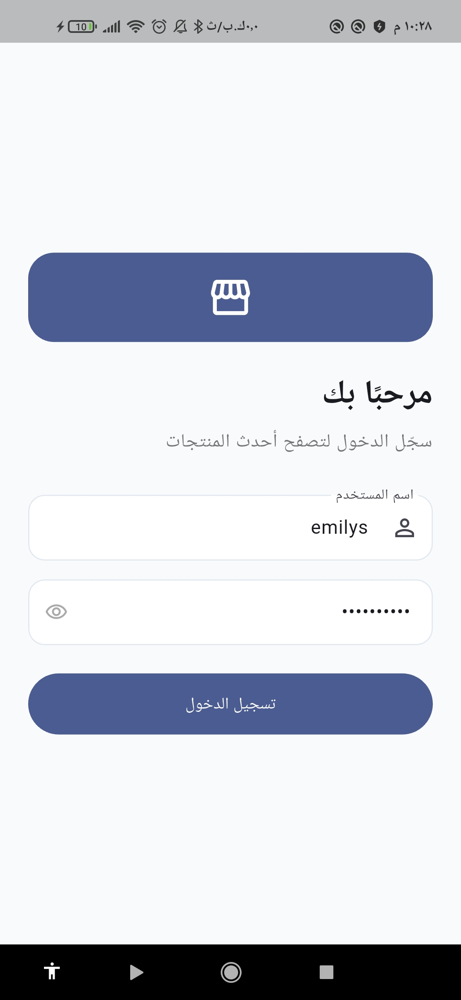
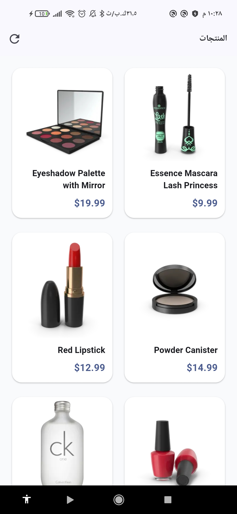
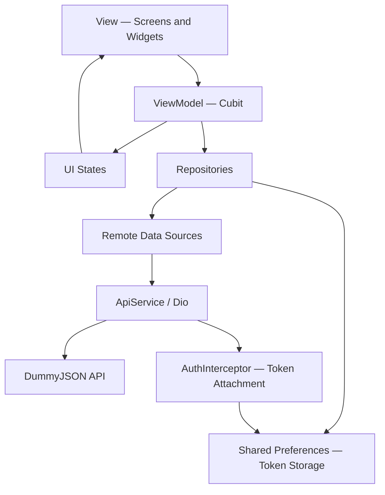

<div dir="ltr">

<h1 align="center">🛍️ Store App — Product Browsing App</h1>

<p align="center">
  A Flutter training project at CS Academy, focused on refactoring an existing app and improving code quality with MVVM.
</p>

<p align="center">
  
  
  
  
  
  
</p>

<p align="center">
  <a href="#about">About</a> ·
  <a href="#project-goal">Project Goal</a> ·
  <a href="#features">Features</a> ·
  <a href="#learning">Learning Experience</a> ·
  <a href="#screens">Screenshots</a> ·
  <a href="#architecture">Architecture</a> ·
  <a href="#tech-stack">Tech Stack</a> ·
  <a href="#getting-started">Getting Started</a>
</p>

---

<a id="about"></a>

## 🛍️ About the App

**Store App (Matjari)** is a Flutter application developed as part of the **Flutter training program at CS Academy**. It lets users sign in with a username and password, then browse products with images, names, and prices. It uses the **DummyJSON API** for authentication and product data, with an Arabic interface and right-to-left layout.

The project started as a simple app written without an architectural structure. The same codebase was then revisited and **refactored using MVVM**. The current structure separates the UI from state management and data access through **Cubit**, **Repositories**, and **Remote Data Sources**, supported by shared networking, local storage, and error-handling services.

This repository documents the experience of improving an existing application, its implemented features, and the technologies and skills applied during refactoring.

<a id="project-goal"></a>

## 🎯 Project Goal and Refactoring Journey

The main goal is to practice working with **an existing project that needs restructuring and improvement**: understanding its code and making it clearer and easier for future developers to maintain and extend.

The training followed two stages:

1. **Initial implementation:** Build the login and product browsing app using a traditional approach, without organizing the code around an architecture or using MVVM.
2. **Refactoring the existing app:** Return to the same application and improve it without rebuilding it from scratch. Apply **MVVM architecture** to separate responsibilities, reduce code duplication, and extract shared widgets and services while preserving login and product browsing behavior.

The exercise focuses on **clean code** with clear names and well-defined responsibilities, separating application logic from the UI so the code is easier to understand, test, and extend. It reflects the work a developer may encounter when taking over an older application that needs refactoring.

<a id="features"></a>

## ✨ Key Features

- 🔐 **Authentication** — Sign in through DummyJSON with a username and password, with required-field validation.
- 🏠 **Product Browsing** — Display products in a two-column grid with an image, name, and price in US dollars.
- 🔄 **Refresh** — Reload products using pull-to-refresh or the refresh button.


## 📱 Screenshots

Screenshots of the app after refactoring. Select any image to view it at full size:

<table>
  <tr>
    <td align="center" width="50%">
      <a href="assets/screenshots/login.jpg"></a>
      <br /><b>Login</b>
    </td>
    <td align="center" width="50%">
      <a href="assets/screenshots/products.jpg"></a>
      <br /><b>Products</b>
    </td>
  </tr>
</table>

<a id="architecture"></a>

## 🏛️ App Architecture

The refactored app follows **MVVM** with a **feature-based folder structure**. Each feature separates its `data` and `presentation` layers, while `core` contains shared services and utilities to reduce duplication.

| Component | Responsibility in This Project |
| :--- | :--- |
| **Model** | Data models such as `AuthAccount` and `ProductModel`, alongside repositories and data sources that access the API and map responses. |
| **View** | Screens and UI components inside `views` and `widgets`, responsible for displaying data and state and receiving user interactions. |
| **ViewModel** | `AuthCubit` and `HomeCubit` inside `view_model`, which call repositories and manage the loading, success, and failure states observed by the UI. |

<div dir="ltr">



</div>

**GetIt** provides dependencies for services, repositories, and Cubits. Repository requests pass through `requestHandler` to return either a successful result or a `Failure`, while `DioErrorMapper` converts network and data errors into messages the UI can display.

### Project Structure

<div dir="ltr">

```text
lib/
├── main.dart                  # Entry point and MaterialApp configuration
├── core/
│   ├── common/                # Input validation utilities
│   ├── constants/             # Strings, API endpoints, and storage keys
│   ├── dependency_injection/  # GetIt dependency registrations
│   ├── extensions/            # Screen, snackbar, and loading helpers
│   ├── routing/               # Routes and screen navigation
│   ├── services/              # Networking, storage, requests, and errors
│   └── themes/                # Shared colors and theme
└── features/
    ├── auth/
    │   ├── data/
    │   │   ├── data_sources/
    │   │   ├── models/
    │   │   └── repositories/
    │   └── presentation/
    │       ├── view_model/
    │       └── views/
    └── home/
        ├── data/
        │   ├── data_sources/
        │   ├── models/
        │   └── repositories/
        └── presentation/
            ├── view_model/
            └── views/
                └── widgets/

test/
└── widget_test.dart            # Widget, authentication, and product tests
```

</div>

The `auth` feature handles login and token storage, while `home` handles product retrieval and display. The `data` layer contains models, data sources, and repositories; `presentation` contains screens, widgets, Cubits, and their states.

<a id="tech-stack"></a>

## 🛠️ Tech Stack

| Purpose | Technology |
| :--- | :--- |
| UI and Language | Flutter, Dart |
| Architecture | MVVM with feature-based organization |
| State Management | Cubit / flutter_bloc |
| Authentication and Product Data | DummyJSON API |
| Networking | Dio with AuthInterceptor |
| Local Storage | shared_preferences / SharedPreferencesAsync |
| Dependency Injection | get_it |
| Result and Error Handling | dartz / Either, Failure, DioErrorMapper |
| Navigation | Flutter Navigator with named routes |
| Styling | Material 3 with a shared light theme |
| Interface Language and Direction | Arabic / RTL |
| Testing | flutter_test |

Package versions are listed in [pubspec.yaml](pubspec.yaml).

<a id="getting-started"></a>

## 🚀 Getting Started

### Prerequisites

- Flutter with Dart `>=3.10.4 <4.0.0`.
- Git and an editor such as VS Code or Android Studio.
- An Android emulator or connected device. For iOS, use macOS and Xcode.
- An internet connection to download dependencies and access the API and product images.

### Run Locally

Clone the repository and install dependencies:

<div dir="ltr">

```bash
git clone https://github.com/ReemMohsn/store_app-.git
cd store_app-
flutter pub get
```

</div>

Use `flutter doctor` to check your development setup and `flutter devices` to list available devices, then launch the app:

<div dir="ltr">

```bash
flutter run
```

</div>

### API Configuration and Demo Login

API settings are defined in [api_end_points.dart](lib/core/constants/api_end_points.dart). The app uses these endpoints:

| Purpose | Request |
| :--- | :--- |
| Base URL | `https://dummyjson.com/` |
| Login | `POST auth/login` |
| Fetch Products | `GET products` |

The current setup connects directly to DummyJSON. The login screen includes demo credentials prefilled in [login_view.dart](lib/features/auth/presentation/views/login_view.dart):

| Field | Value |
| :--- | :--- |
| Username | `emilys` |
| Password | `emilyspass` |

After launching the app, submit the login form to open the products screen. Refresh the list by pulling down or pressing the refresh button, and use the retry button if loading fails. The app's interface is in Arabic.

## 👩‍💻 Author

[ReemMohsn](https://github.com/ReemMohsn)

Built during the Flutter training program at **CS Academy**.

</div>
